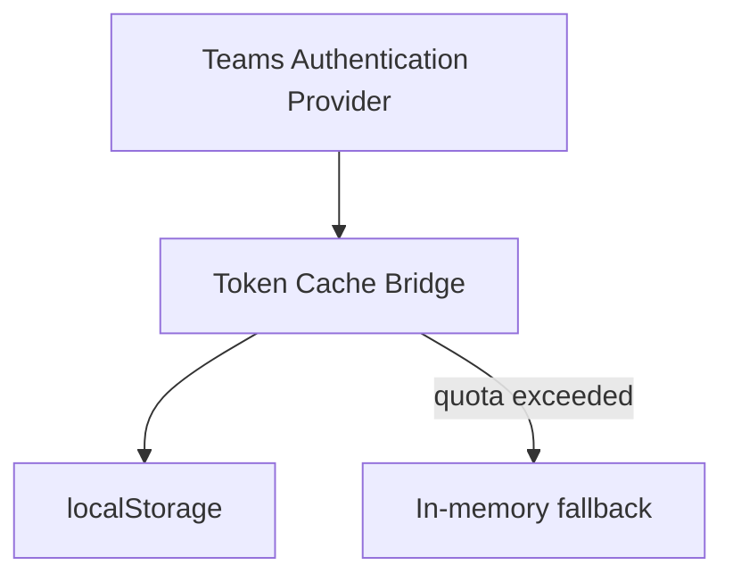

# Token Cache Architecture

{/* toc */}

## Overview

The token cache gives Microsoft Teams' authentication provider the `_tokenCache` storage interface it looks for. The decision behind it is recorded in [ADR-002](adr/002-token-cache-secure-storage.md), which was written to stop the re-authentication prompts users reported roughly every 24 hours, after sleep and after restarts.

The cache is a bridge, not a store of its own: values go to the page's `localStorage`, where Teams already keeps its tokens. It does not encrypt anything.

## How It Works



### TeamsTokenCache

`app/browser/tools/tokenCache.js` exports a singleton with a `localStorage`-compatible, promise-returning interface:

- `getItem(key)`, `setItem(key, value)` and `removeItem(key)` pass through to `localStorage`
- `clear()` removes only the keys that look authentication-related, not the whole store
- `getCacheStats()` returns counts and which backend is in use, for diagnostics

If `localStorage` reports that its quota is exceeded, the cache switches to an in-memory `Map` for the rest of the session, so tokens written after that point are lost on restart.

### Injection

`app/browser/tools/reactHandler.js` assigns the cache to the Teams authentication provider when it finds one, and only on a Teams host:

```javascript
authProvider._tokenCache = TokenCache;
```

### Key Patterns

`clear()` and `getCacheStats()` treat a key as authentication-related when it contains one of these: `tmp.auth.v1.`, `refresh_token`, `msal.token`, `EncryptionKey`, `authSessionId`, `LogoutState`, `accessToken`, `idtoken`, `Account`, `Authority`, `ClientInfo`.

## Security

Tokens are stored as Teams itself stores them: in `localStorage`, unencrypted, inside the application's profile directory. Any process running as the user can read them, so disk encryption and the security of the user account are what protect them at rest. See [Token Storage](security-architecture.md#token-storage) in the security architecture.

The cache object is assigned onto an object that page script can reach, which gives the page nothing it did not already have, since the page owns its `localStorage`.

### Why There Is No Encryption

An earlier version tried to encrypt values with Electron's `safeStorage`. That module exists only in the main process, and the cache runs in the renderer's preload script, so the encrypted path never ran and has been removed. Encrypting in the main process instead would not help: Teams writes the same tokens to its own storage, so an encrypted copy protects nothing while the plain ones exist.

## Logging

The cache logs with a `[TOKEN_CACHE]` prefix and never logs token values. Keys in warnings have UUIDs shortened. To see the debug lines:

```bash
ELECTRON_DEBUG_LOGGING=true npm start
```

At startup it logs whether `localStorage` is available:

```text
[TOKEN_CACHE] TokenCache initialized { localStorage: true }
```

Older versions also logged a "Secure storage not available" line. It reflected the encryption path that never ran and was not a fault.

## Troubleshooting

### Memory Fallback Active

**Symptoms**: Logs show "Storage quota exceeded, switching to memory fallback"
**Cause**: `localStorage` quota exceeded
**Resolution**: Tokens are kept in memory for the current session only. Clearing the application's storage frees the quota.

### Still Asked To Sign In

The cache only provides the storage interface. Sign-in prompts can also come from the tenant's sign-in frequency policy or from expired refresh tokens, which no client-side cache can change.

## Not Planned

- **Custom MSAL Integration**: Would require developer app registration
- **Token Value Modification**: The cache only provides the interface and does not alter tokens
- **Encrypted Token Storage**: See "Why There Is No Encryption" above
